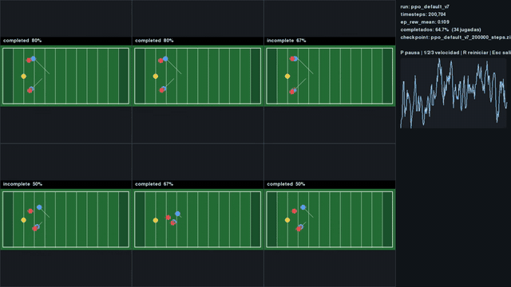
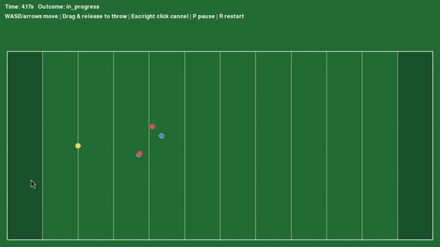
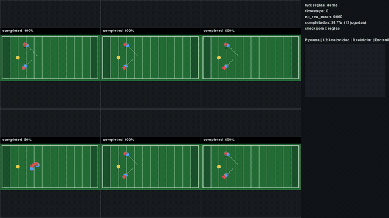
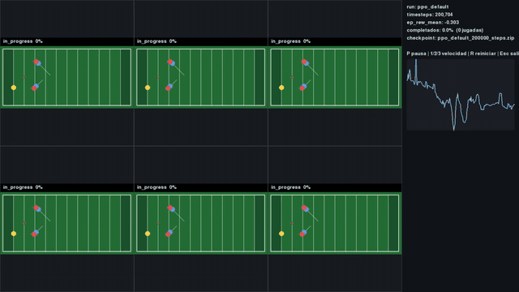
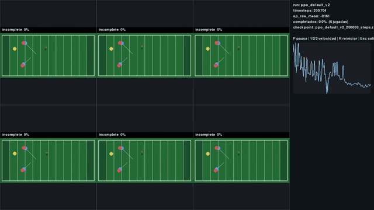
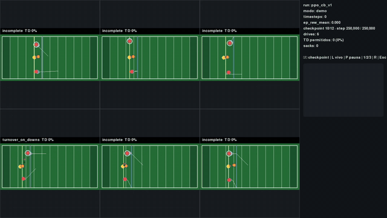
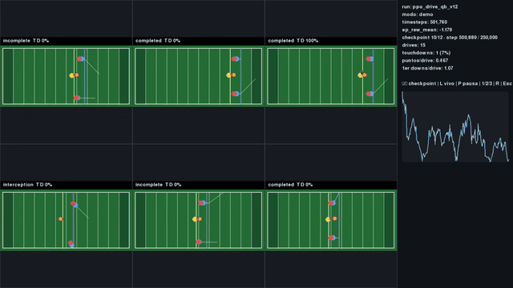
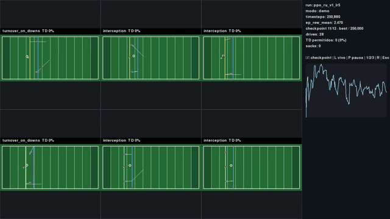

<div align="center">

# Football Simulator RL

Reinforcement learning investigation for a 2D football passing simulator



<sub>Six parallel plays, PPO with a behavior-cloning warm start</sub>

</div>

A small, deterministic, headless-first 2D American football simulator built for reinforcement-learning research. One quarterback, two receivers and a defense (two cornerbacks plus a dedicated pass rusher) play on the same engine whether a human, a hand-written rule, or a trained policy is in control. A human aims with a Retro Bowl-style drag-and-release slingshot, and that `(angle, power)` gesture is exactly the action the learned agents output, so every comparison between human, rules and RL is fair.

The project grew in stages: first a single play, then agents that learn each role, then full three-down drives.

## 1. Engine first



A deterministic `Play` (pass, catch, interception, tackle, sack, out of bounds, time limit) with throw accuracy that degrades with QB speed, defensive pressure and distance, driven by a seedable RNG. Drag back, release, and the dotted arc shows where the ball goes.

<br clear="right">

## 2. The rule-based baseline



Before any learning: route-running receivers, man-coverage defenders and a heuristic quarterback that throws when someone is open. Every learned agent has to beat it, and later it also becomes the teacher for behavior cloning.

<br clear="left">

## 3. The QB learns, and cheats twice

PPO quarterbacks found loopholes in the reward function (200k steps each):

| The coward | The spammer |
| :---: | :---: |
|  |  |
| Never threw. Running out the clock (-0.5) hurt less than an interception or sack (-1.0), so it jogged backwards for six seconds. | Threw at second 0.0 to nobody. Once the clock penalty rose, an incompletion (-0.2) became the cheapest outcome: 100% incomplete. |

Three fixes killed both: a minimum time before throw-attempt shaping counts, a pass rusher that makes waiting costly, and a behavior-cloning warm start that imitates the rule QB before PPO fine-tuning begins. That produced the first presentable QB (`v7`, the GIF at the top), and with the rusher, `v8`, which learned to throw while scrambling to escape pressure (81% completions vs 55% for the rules at 100k steps in the `rushed` scenario).

## 4. Every role learns



Receivers learn to run and catch from a pool of 8 routes sampled per play, cornerbacks learn coverage with potential-based reward shaping, and the pass rusher stays on behavior cloning because PPO degraded it. Training the roles against each other gave a retrained drive QB (`v12`) that struggles against teammates who learned their jobs. That's the open balance problem.

<br clear="right">



QB `v12` in this clip sits at 6% touchdowns (4 of 61 drives), a mid-evaluation snapshot rather than the final number.

<br clear="left">

## 5. A reward hack that became a rule



With a tiny learning rate (5e-6) the rusher turned into a pure ball hawk: 53.7% forced interceptions and 0.56% completions allowed without ever reaching the QB. It's documented as an experiment, and the engine now bars rushers from touching the ball in flight.

<br clear="right">

## 6. Drives

`rules/drive.py` chains plays into a drive (3 downs, 10 yards, line of scrimmage 25-50, goal line at x=100, touchdown = 7 points). The drive-aware QB `v11` observes 57 floats (down, distance, yards to goal, route one-hots) and beats the rule QB over the same 100 seeded drives:

| Metric | Rules | QB v11 |
| --- | :---: | :---: |
| Touchdowns | 21% | **30%** |
| Points / drive | 1.47 | **2.10** |
| 3rd-down conversion | 32.2% | **43.3%** |
| Interceptions | 49% | **37%** |

## Bugs worth knowing about

| Bug | Fix |
| --- | --- |
| Behavior cloning assumed a tanh-squashed policy, but SB3 2.9 uses an unsquashed Gaussian, so aim collapsed | Raw-action targets plus BCE for the throw trigger |
| Pure zero-sum reward degraded CB coverage (1.74 -> 2.65 yd) | Potential-based shaping `gamma*phi(s') - phi(s)`, invariant to the optimal policy |
| WR behavior cloning drifted over time | Next-waypoint features in the observation |
| Receiver start ignored the line-of-scrimmage shift in drives | Pass the shifted start to the receiver policy |
| Evaluations without provenance or confidence intervals | Metadata envelope and Wilson 95% intervals on all proportions |

## Reproducing the evaluations

Numbers above come from 100 episodes on seeds 10000+, separate from training seeds, with Wilson 95% intervals (`scripts/evaluate_ppo.py`, `scripts/evaluate_drive.py`, `scripts/evaluate_stage_b.py`). Training runs live under `runs/`, which is gitignored, so checkpoints are not included in this repo.

---

# Reference

The sections below document the engine, environments and tooling.

## Coordinates

Positions are measured in yards. The origin is the lower-left corner of the field, `x` increases downfield toward the opponent's end zone, and `y` increases across the width. The default field bounds are 120 yards long by 53.3 yards wide.

## Setup

```bash
python -m pip install -e ".[dev]"

# Optional visualizer. `pygame` has no wheel for Python 3.14, so the project uses
# the API-compatible `pygame-ce`.
python -m pip install -e ".[dev,viz]"
```

## Checks

```bash
python -m pytest
ruff check .
ruff format --check .
```

## Public API

- `Play(config=None, seed=0)`: the mechanical rules engine for one play with a quarterback (`qb`), two receivers (`wr1`, `wr2`), and two defenders (`cb1`, `cb2`). It only applies actions and resolves physics; decisions live in agents. The local seeded NumPy generator drives contextual throw deviation.
- `Play.reset(seed=None)`: restores the roster and starting positions; passing a seed re-seeds the generator, omitting it keeps advancing the sequence so episodes vary.
- `Play.step(actions=None)`: advances one fixed tick applying a `Mapping[str, Move | Throw]` keyed by player id. Actions do not persist between ticks, a missing action means standing still, unknown players and actions not allowed for a role raise `ValueError`, and terminal states do not advance again.
- `Move(direction)`: moves a player in a direction of magnitude at most 1 (speed depends on the role).
- `Throw(direction, power=1.0)`: quarterback-only throw at an angle with a force fraction in `[0, 1]`; `power` maps to a landing range between `throw_min_range` and `throw_max_range`. This `(angle, force)` representation is what a human drag gesture produces and what an RL policy can learn directly.
- `Play.throw_to(target, power=None)` and `Play.throw_with_lead(lead_seconds, player_id="wr1", power=None)` are immediate shortcuts that derive the angle from a field point (and the power from its distance when omitted).
- `PlayState.players` + `PlayState.player(player_id)`: roster state by stable id; `carrier_id` identifies the ball carrier; `pressure` exposes the 0..1 pressure from the nearest defender; `throw_time` records when the ball was released.
- `PlayOutcome`: `IN_PROGRESS`, `COMPLETED`, `INTERCEPTION`, `INCOMPLETE`, `OUT_OF_BOUNDS`, or `TIME_LIMIT`.

## Agents and scenarios

- `agents.base.BaseAgent` is the common interface: one instance per player with `observe(state)`, `act(observation)`, and `decide(state)`. Observations are frozen dataclasses with role-local information only.
- `agents.rule_controllers` provides `ReceiverRouteController`, `ManCoverageController`, and `HeuristicQuarterback`; learned policies will implement the same interface.
- `rules.scenarios.Scenario` bundles config, routes, and a base seed; `default`, `pressured`, and `deep` are available through `get_scenario`.
- `agents.loop.run_play(...)` and `run_series(...)` run reproducible headless plays; `run_play(..., recorder=PlayRecorder())` writes a JSONL trace.

## Recording, replay, and metrics

- `recording.PlayRecorder` writes a JSONL header (seed, scenario, config, routes), one line per tick with per-player actions, and a final result line; `recording.replay(record)` rebuilds the play from the seed and actions and raises `ValueError` if the trace diverges.
- `metrics.summarize(results, line_of_scrimmage)` aggregates completion/interception/incompletion percentages, yards per attempt and per completion, average time to throw, and average duration.
- `python scripts/rule_baseline_report.py` prints reproducible baseline metrics per scenario; `python scripts/accuracy_report.py` covers throw-accuracy calibration.

Play rules: after a catch the ball becomes `CARRIED`, the receiver runs downfield, and the play ends when any defender touches the carrier (`tackle_radius`), the carrier leaves the field, or time expires (still `COMPLETED`). An interception ends the play immediately, and a defender touching the quarterback while he holds the ball ends the play with `SACK`. There is no automatic receiver selection or catch assistance.

The `rushed` scenario fields two cornerbacks (`cb1` covers `wr1`, `cb2` covers `wr2`) plus a dedicated pass rusher (`ru1`) that hunts the quarterback, creating sack pressure and forcing the QB to decide when to throw.

Pass flight is a parabolic arc: `BallState.height` follows `4 · peak · p · (1 − p)` with `peak = min(max_arc_height, distance · arc_ratio)`. A player can only touch the ball when its height is at most `catch_height`, so well-thrown passes can clear defenders; interceptions happen near the launch or landing points or on flat throws.

## Contextual accuracy

Throws leave with a deviation drawn from a local seeded NumPy generator. The angular sigma (configured in degrees) grows with quarterback speed, defensive pressure (nearest defender inside `pressure_radius`), and pass distance; power noise is applied in the normalized `power` range and clipped to `[0, 1]`. Parameters: `throw_base_sigma_degrees`, `throw_move_penalty`, `throw_pressure_penalty`, `throw_distance_penalty`, `throw_power_sigma`. Deviation changes the ball's launch direction and range, so catches, interceptions, and incompletions still come from physics and player interactions — never from an artificial incompletion probability. The aim preview shows the intended throw without noise; the error is drawn only when the throw executes.

Run `python scripts/accuracy_report.py` for a reproducible calibration report over fixed seeds (spread statistics and outcome distributions for planted, moving, and pressured throws).

## Gymnasium environment (M4)

`qb_sim.training.QBPassingEnv` trains the quarterback while receivers and defenders use the M3 rule controllers. Importing `qb_sim.training` registers it as `QBPassing-v0`:

```python
import gymnasium as gym
import qb_sim.training  # noqa: F401 - registers QBPassing-v0

env = gym.make("QBPassing-v0")
```

- **Observation** (36 floats in `[-1, 1]`): QB position/velocity, ball status one-hot + height, up to 2 receiver slots and 3 defender slots (relative position and velocity, rushers included) with presence flags for empty slots, pressure, and remaining time. The fixed layout lets one policy play any roster.
- **Action** (6 floats in `[-1, 1]`): `[move_x, move_y, aim_x, aim_y, power_raw, throw_trigger]`; a positive trigger throws toward `(aim_x, aim_y)` with `power = (power_raw + 1) / 2`, otherwise the QB moves. Human and learned policies share the same engine actions.
- **Rewards** (`training.rewards.RewardConfig`): completion plus yardage, penalties for interception/incompletion/out-of-bounds/time limit/sack, and a small per-tick time penalty; every coefficient is configurable.
- **Episodes**: terminate when the play outcome is terminal, truncate at `max_steps`; `reset(seed=...)` is reproducible and `info` exposes the episode seed, outcome, pressure, throw time, and carrier.
- **Multi-scenario**: `--scenarios default,rushed,pressured,deep` cycles a different scenario every episode (`training.multiscenario`). A single policy trained across all four was not stable with kinematic observations alone; single-scenario training remains the reliable path and multi-task context features are a pending experiment.

## PPO training (M5)

Training is headless, lives in `qb_sim.training`, and never loads Pygame. Install the RL extras and run:

```bash
python -m pip install -e ".[dev,viz,rl]"
python -m qb_sim.training.train --timesteps 200000 --seed 0 --scenario rushed --run-name ppo_default_v7
```

The pipeline:

- **Behavior-cloning warm start** (`training.imitation`): the rule QB plays `imitation_episodes` seeded episodes in the scenario; its `(observation, action)` pairs train an MLP matching the PPO policy network (throw samples are upweighted) and the weights are loaded into the actor. This solves the hard-exploration problem of precise aiming.
- **Conservative PPO fine-tuning**: small learning rate (`2e-5`), low clip range, `target_kl` early stopping, no entropy bonus, and small `log_std_init`, so the fine-tuning improves the imitated policy instead of destroying it. The attempt shaping is annealed to zero by default (`attempt_decay_steps`).
- **Artifacts**: `runs/<run-name>/` contains `final_model.zip`, `config.json` (hyperparameters, scenario, seed, imitation stats, device), `checkpoints/`, `best/`, and CSV learning curves under `logs/`. Resume with `--resume runs/<run>/checkpoints/<file>.zip`.

Evaluation uses a fixed seed set separate from training:

```bash
python scripts/evaluate_ppo.py --episodes 100 --seed-start 10000 \
    --ppo rules=runs/qb/play/history/ppo_default_v7/final_model.zip --output runs/reports/evaluation.json
python scripts/analyze_ppo.py --model runs/qb/play/history/ppo_default_v7/final_model.zip --scenario rushed
```

## Training dashboard (video)

A live Pygame dashboard shows six parallel plays whose QB loads the newest checkpoint every few seconds, plus timesteps, `ep_rew_mean`, live completion rate, and the learning curve:

```bash
python scripts/train_dashboard.py --train --run-name ppo_default_v7 --scenario rushed
```

Controls: `P` pause, `1/2/3` speed, `R` restart panels, `Esc` exit. Record the window with OBS or any screen recorder. To inspect a finished run instead, omit `--train`; to show the rule QB for contrast, point it at a run directory without checkpoints. Pass rushers are highlighted in orange in every panel.

## Multi-agent environment (M6)

`qb_sim.training.multiagent.QBPassingMultiAgentEnv` is a PettingZoo `ParallelEnv` where every player decides for itself (install with `python -m pip install -e ".[multi]"`):

- **Agents**: `qb`, the receivers (`wr1`, `wr2`), and every defender including the rusher (`cb1`, `cb2`, `ru1`).
- **Observations**: the QB uses the 36-float layout; receivers and defenders use a 19-float role-local layout (`training/role_observations.py`).
- **Actions**: the QB keeps the 6-float hybrid action; every other role moves with a 2-float direction.
- **Rewards**: zero-sum at the terminal step — offense gets the single-agent terminal reward, defense gets its negative — plus the per-tick time penalty on offense.
- **Rule compatibility**: `run_rule_episode(env, seed)` runs the M3 rule controllers as every player's policy; the human session and the single-agent environment are unchanged.

```python
from qb_sim.rules.scenarios import RUSHED_SCENARIO
from qb_sim.training.multiagent import QBPassingMultiAgentEnv, run_rule_episode

env = QBPassingMultiAgentEnv(RUSHED_SCENARIO)
print(run_rule_episode(env, seed=0)["outcome"])
```

MARL training with shared per-role policies (MAPPO) belongs to M7.

## Controls (visualizer)

Drag-and-throw, Retro Bowl style (slingshot):

| Input | Action |
| --- | --- |
| `WASD` or arrow keys | Move the quarterback |
| Hold left mouse and pull back | Aim: pull away from where you want the ball to go; drag length is the power |
| Release left mouse | Throw to the landing point shown by the dotted line |
| `Esc` or right click | Cancel the aim without throwing |
| `P` | Pause / resume |
| `R` | Restart the play |

The dotted aim line is a parabola sampled from the same arc the ball will fly, and its landing marker updates in real time with a color that changes with power; a drag shorter than `throw_min_drag` is ignored to avoid accidental throws. Human input is translated into the same `Move`/`Throw` actions used by scripted and future learned policies; the visual layer contains no game logic.

## Headless session

`PlaySession` drives a play from translated human input without importing Pygame:

```python
from qb_sim import Play
from qb_sim.engine.geometry import vec2
from qb_sim.ui.session import FrameInput, PlaySession

session = PlaySession(Play())
session.step_frame(FrameInput(held=frozenset({"w"})))
session.step_frame(FrameInput(mouse_field=vec2(50.0, 26.65), mouse_down=True))
session.step_frame(FrameInput(mouse_field=vec2(30.0, 26.65), mouse_down=True))
session.step_frame(FrameInput(mouse_field=vec2(30.0, 26.65), mouse_released=True))

print(session.play.state.outcome, session.play.state.ball.position)
```

## Visualizer

```bash
python -m qb_sim.ui.pygame_app                      # rushed by default: an orange pass rusher hunts the QB
python -m qb_sim.ui.pygame_app --scenario default   # no rusher
python -m qb_sim.ui.pygame_app --model runs/qb/play/history/ppo_default_v7/final_model.zip --scenario rushed
```

The pass rusher is drawn in orange with a dark outline; the other defenders are red. `--scenario` selects any registered scenario. The simulator itself never depends on a display. Multi-agent play belongs to a later milestone.
